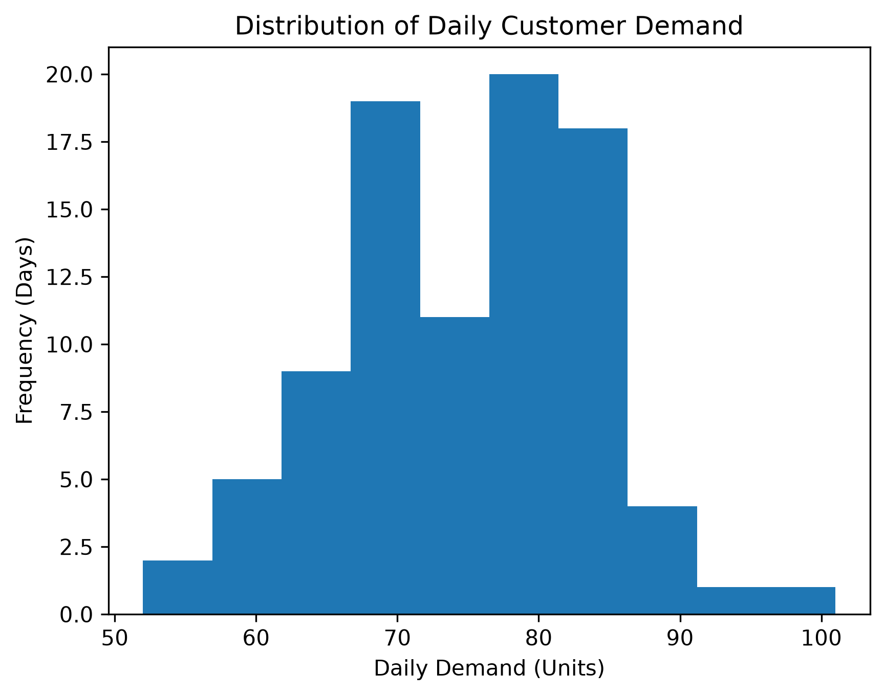
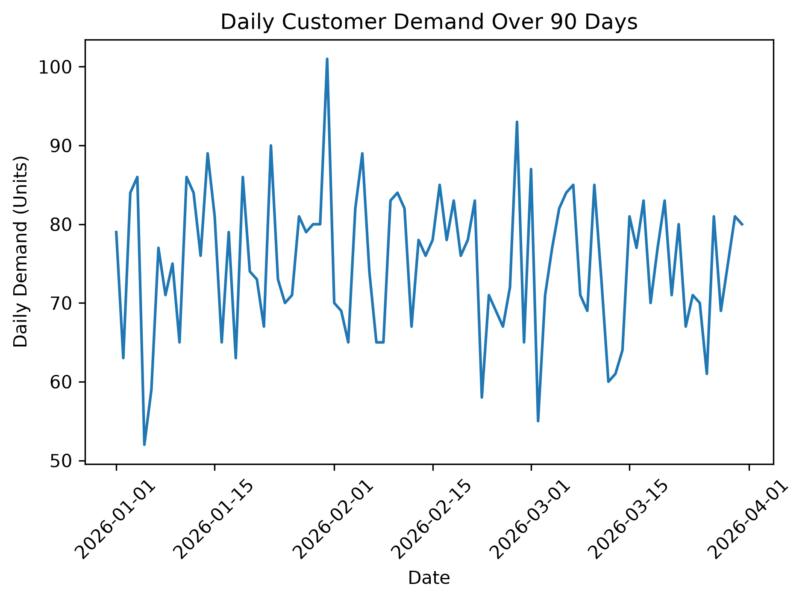

# Inventory Risk & Profit Optimization Using Monte Carlo Simulation

[](https://colab.research.google.com/github/alishbashahbaz/inventory-monte-carlo-optimization/blob/main/inventory_monte_carlo_optimization.ipynb)

## Project Overview

This project uses Python and Monte Carlo simulation to evaluate inventory decisions under uncertain customer demand.

The objective is to identify inventory target levels that balance profitability, inventory holding costs, and the risk of unmet demand.

The model simulates 1,000 independent 90-day demand scenarios and compares alternative inventory policies using profit, shortages, independent validation, and sensitivity analysis.

## Business Problem

Businesses must decide how much inventory to hold without knowing future customer demand with certainty.

Holding too much inventory increases carrying costs, while holding too little inventory increases the risk of stock shortages and lost sales.

This project uses simulation-based analysis to evaluate this trade-off and identify inventory policies that perform well under uncertainty.

## Project Objectives

- Generate and validate a synthetic daily demand dataset.
- Explore demand behaviour using descriptive statistics and visualizations.
- Build a daily inventory simulation model.
- Simulate 90-day inventory performance.
- Run 1,000 Monte Carlo demand scenarios.
- Compare multiple target stock levels.
- Refine the search around the strongest-performing stock levels.
- Validate the selected policy using independent demand scenarios.
- Quantify the uncertainty around the profit difference.
- Test how the recommendation changes under different demand conditions.

## Technologies

- Python
- NumPy
- Pandas
- Matplotlib
- Jupyter Notebook

## Dataset

The project uses a synthetic 90-day daily demand dataset.

Demand was generated using a normal distribution with:

- Mean daily demand: **75 units**
- Standard deviation: **12 units**
- Simulation horizon: **90 days**

The generated values were rounded to whole units and constrained to prevent negative demand.

Synthetic data was used because real commercial inventory data was not available.

## Model Assumptions

The inventory model uses the following simplified assumptions:

| Parameter | Value |
|---|---:|
| Selling price | Rs. 200 per unit |
| Unit purchase cost | Rs. 120 per unit |
| Holding cost | Rs. 3 per ending inventory unit |
| Initial inventory | 35 units |
| Simulation horizon | 90 days |
| Monte Carlo scenarios | 1,000 |

Additional assumptions include:

- Inventory is non-perishable.
- Unsold inventory carries forward to the next day.
- Replenishment is immediate.
- Customer demand above available stock is treated as lost sales.
- Financial parameters remain constant.
- No explicit additional stockout penalty is applied.
- Supplier lead times and fixed ordering costs are excluded.

## Methodology

The project follows the workflow below:

1. Generate synthetic customer demand.
2. Validate the dataset.
3. Perform exploratory data analysis.
4. Build a reusable daily inventory simulation function.
5. Simulate one complete 90-day inventory cycle.
6. Run 1,000 Monte Carlo demand scenarios.
7. Compare alternative inventory target levels.
8. Refine the optimization search.
9. Validate the selected policy on independent demand scenarios.
10. Estimate a confidence interval for the policy difference.
11. Perform sensitivity analysis under changing demand conditions.

## Daily Inventory Logic

For each simulated day:

```text
Order Quantity = max(0, Target Stock - Opening Inventory)

Available Stock = Opening Inventory + Order Quantity

Units Sold = min(Available Stock, Customer Demand)

Shortage Units = max(0, Customer Demand - Available Stock)

Ending Inventory = Available Stock - Units Sold
```

Daily profit is calculated using:

```text
Daily Profit =
Sales Revenue
- Cost of Goods Sold
- Inventory Holding Cost
```

## Monte Carlo Simulation

The model generated **1,000 independent 90-day demand scenarios**.

For the initial target stock level of 100 units, simulated 90-day profit produced approximately:

| Metric | Result |
|---|---:|
| Mean profit | Rs. 532,708.01 |
| Standard deviation | Rs. 9,320.11 |
| Median profit | Rs. 532,793.50 |
| Minimum profit | Rs. 507,105 |
| Maximum profit | Rs. 562,134 |

This allowed inventory performance to be evaluated across many possible demand outcomes rather than relying on one demand path.

## Inventory Optimization

An initial comparison evaluated target stock levels:

```text
70, 80, 90, 100, 110, 120
```

A refined search then evaluated every target between:

```text
90 and 110 units
```

The highest mean profit among the tested baseline policies occurred at:

**97 units**

| Target Stock | Mean 90-Day Profit |
|---|---:|
| 97 units | Rs. 532,943.15 |
| 100 units | Rs. 532,708.01 |

The improvement was:

**Rs. 235.14 over 90 days**

The small difference indicated that the model should not treat 97 units as a universally superior policy without additional validation.

## Independent Validation

The 97-unit and 100-unit policies were evaluated using a new set of 1,000 independent demand scenarios.

Results:

| Metric | 97 Units | 100 Units |
|---|---:|---:|
| Mean 90-day profit | Rs. 532,223.38 | Rs. 531,952.38 |
| Average shortage units | 13.469 | 6.975 |

The 97-unit policy generated an average additional profit of:

**Rs. 271.00 over 90 days**

However, it also produced substantially more unmet demand.

## Statistical Validation

A paired comparison was performed using the same validation demand scenarios for both policies.

Mean profit difference:

**Rs. 270.998**

Approximate 95% confidence interval:

**Rs. 249.75 to Rs. 292.24**

The interval remained above zero under the simulation assumptions, supporting a positive expected profit difference for the 97-unit policy.

However, statistical evidence of a difference does not mean that the difference is economically large.

## Sensitivity Analysis

The 97-unit and 100-unit policies were tested under different average daily demand conditions.

| Mean Daily Demand | Profit Difference: 97 - 100 | Better Policy |
|---:|---:|---|
| 65 units | +Rs. 746.26 | 97 units |
| 75 units | +Rs. 255.56 | 97 units |
| 85 units | -Rs. 2,126.46 | 100 units |

At high demand, the 100-unit policy became more profitable and produced fewer shortages.

This demonstrates that the preferred inventory policy depends on expected demand conditions.

## Key Findings

- The highest-profit tested baseline policy was **97 units**.
- Its profit advantage over 100 units was small.
- Independent validation supported the positive profit difference.
- The 97-unit policy produced more unmet demand.
- Under higher average demand, the 100-unit policy became more profitable.
- Inventory targets should therefore adapt when demand conditions change.

## Business Recommendation

Under the baseline assumptions, a target stock level of **97 units** provides the highest modeled mean profit among the tested policies.

However, the financial advantage over 100 units is small, while the 100-unit policy provides better protection against shortages.

Therefore:

- A profit-focused business operating near the baseline demand level may prefer a target close to 97 units.
- A business that prioritizes service levels and shortage reduction may prefer 100 units.
- Inventory targets should be reviewed when expected demand changes.

## Visualizations

### Demand Distribution



### Daily Demand Over Time



### Inventory Optimization


*The Y-axis is zoomed to highlight small differences in mean profit between inventory policies.*

### Demand Sensitivity Analysis


## Repository Structure

```text
inventory-monte-carlo-optimization/
│
├── README.md
├── inventory_monte_carlo_optimization.ipynb
├── requirements.txt
├── .gitignore
│
├── data/
│   └── synthetic_daily_demand.csv
│
└── figures/
    ├── demand_distribution.png
    ├── daily_demand_timeseries.png
    ├── inventory_optimization.png
    └── demand_sensitivity.png
```

## How to Run

Clone the repository:

```bash
git clone https://github.com/alishbashahbaz/inventory-monte-carlo-optimization.git
```

Move into the project directory:

```bash
cd inventory-monte-carlo-optimization
```

Install the required packages:

```bash
pip install -r requirements.txt
```

Open the Jupyter Notebook:

```bash
jupyter notebook inventory_monte_carlo_optimization.ipynb
```

Alternatively, use the **Open in Colab** button at the top of this README.

## Limitations

- Customer demand is synthetic rather than based on real commercial transactions.
- Demand is modeled using a normal distribution.
- Replenishment is assumed to be immediate.
- Supplier lead times are not modeled.
- Selling prices and costs remain constant.
- Fixed ordering costs are excluded.
- No explicit additional stockout penalty is applied.
- Lost demand is not backordered.
- The optimization evaluates a defined range of stock levels rather than every possible inventory policy.
- Results are conditional on the assumptions of the model.

## Conclusion

Monte Carlo simulation provides a practical framework for evaluating inventory decisions under uncertainty.

The project demonstrates that a policy with the highest simulated profit may not automatically be the strongest business decision once shortage risk and changing demand conditions are considered.

The results support using simulation, validation, and sensitivity analysis together when making inventory decisions.
