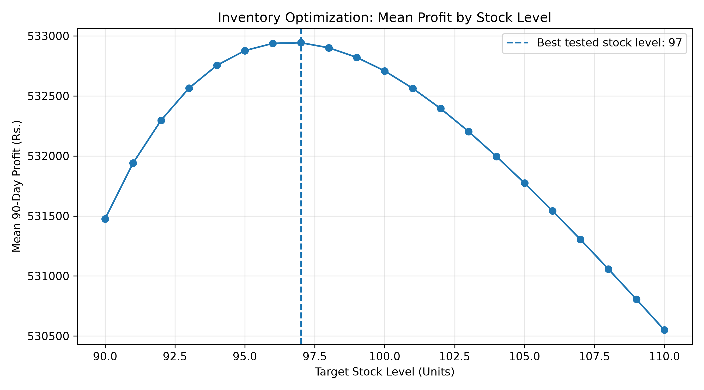
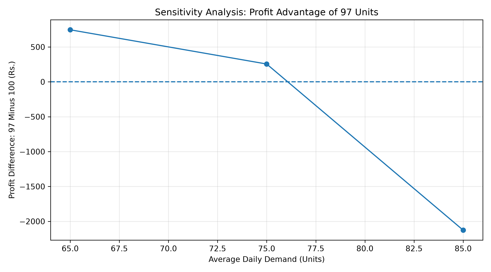

# Inventory Risk & Profit Optimization Using Monte Carlo Simulation

## Project Overview

This project uses Python and Monte Carlo simulation to evaluate inventory policies under uncertain customer demand.

The model simulates daily inventory, sales, shortages, holding costs and profit across 1,000 independent 90-day demand scenarios.

## Technologies

- Python
- NumPy
- Pandas
- Matplotlib
- Jupyter Notebook

## Key Results

- Best tested baseline inventory target: **97 units**
- Mean 90-day profit at 97 units: **Rs. 532,943.15**
- Mean 90-day profit at 100 units: **Rs. 532,708.01**
- Independent validation profit advantage of 97 units: **Rs. 271.00**
- Approximate 95% confidence interval: **Rs. 249.75 to Rs. 292.24**

Sensitivity analysis showed that 97 units performed better at lower and baseline demand, while 100 units performed better when average demand increased to 85 units per day.

## Main Insight

The highest-profit inventory policy depends on demand conditions. A slightly lower stock target can reduce holding costs, but may increase unmet demand.

## Limitations

- Synthetic demand data
- Immediate replenishment assumption
- Fixed selling price and costs
- No supplier lead time
- No explicit stockout penalty
- Results are conditional on the tested assumptions

## Visualizations

